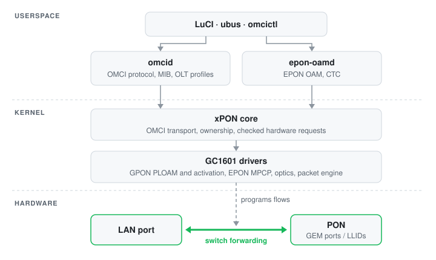

# OpenWrt for the TP-Link XZ000-G7

OpenWrt with Linux 6.18 for the TP-Link XZ000-G7 GPON/EPON ONU, built on the
GalaChip GC1601 SoC (Faraday FA626TE, ARMv5TE). It supports the **32 MiB RAM,
4 MiB SPI NOR, one Gigabit Ethernet port** board. The 8 MiB v1.20 BR/TR
variants are not covered.

The device is an ONU bridge. Use a separate router for PPPoE/IPoE, NAT, DHCP
and firewalling. OLT provisioning and authentication requirements vary by ISP.

## Status

| Area | State |
| --- | --- |
| GPON | Working: activation, ranging, encryption, OMCI provisioning, recovery after fibre outages |
| EPON | Working: MPCP registration, OAM with CTC authentication and VLAN modes |
| Datapath | Hardware switch offload between the LAN port and the PON at line rate |
| OMCI | Userspace responder (`omcid`); the kernel engine has been removed |
| LuCI | Status and configuration for GPON, EPON and the PON mode, with a light/dark theme |
| Tested OLT | Nokia ISAM (GPON, India) |

## Features

- GPON and EPON, switchable from LuCI.
- Gigabit Ethernet with hardware bridge offload between the LAN port and the
  PON. Subscriber traffic does not pass through the CPU.
- Tagged, untagged and transparent VLAN operation, or VLANs set by the OLT.
- OMCI in userspace (`omcid`): MIB, transactions, alarms, performance data and
  OLT interoperability profiles, restartable without losing the OLT session.
- Automatic recovery after fibre outages: the service mapping is restored as
  soon as the ONU ranges again.
- ONU identity cloning (serial, vendor ID, versions, equipment ID, SLID/LOID)
  with the field limits the OMCI and CTC formats allow.
- LuCI with the Slate theme (light, dark or automatic), served by uhttpd's
  ucode plugin, which compiles LuCI once instead of on every request.
- GPON and EPON status pages with receive and transmit power against the
  optical class window, the activation stages in words, what the OLT
  provisioned, and the line state in the header of every page. Settings show
  whether saving applies at once, at the next registration or interrupts
  service. A diagnostic report (identifiers masked) downloads from the status
  page.
- `luci-app-xpon-stats` for the router behind the ONU: the same GPON or EPON
  status in that router's LuCI (any theme), or `xpon-stats` in its shell, read
  from the ONU's read-only status API.
- SSH diagnostics: `omcictl`, sysfs counters, an on-demand OMCI trace and a
  one-line log of what the OLT did after each reconnect.
- RAM boot and installation through the stock U-Boot.

## How it works



Subscriber traffic is forwarded by the switch hardware; `omcid` only
configures it. The kernel keeps what needs hardware access or tight timing
(activation, PLOAM, encryption keys, optical safety, DMA) and checks every
request `omcid` makes.

## Stock firmware compared

The stock firmware is TP-Link's December 2024 release for this board.

### Platform

| | Stock firmware | This firmware |
| --- | --- | --- |
| Base system | Linux 3.16, uClibc, TP-Link web interface | OpenWrt, Linux 6.18, musl, LuCI |
| Source | GPL kernel parts; PON and switch drivers (`xpon_sdk.ko`, `gcnet.ko`) and the OMCI daemon (`gc_omcid`) are binary only | All drivers and daemons are source |
| Management | Web interface, TR-069 | LuCI, ubus, SSH |
| Image | Vendor firmware format | OpenWrt sysupgrade (about 3.2 MiB of the 3.4 MiB image limit) |
| Updates | Vendor images | `sysupgrade`, settings kept |

### PON stack

| | Stock firmware | This firmware |
| --- | --- | --- |
| GPON activation and PLOAM | Inside `xpon_sdk.ko` | `gc1601-gpon` driver, checked against G.984.3 (2014) with amendments 1 and 2 |
| OMCI | `gc_omcid`, closed | `omcid`, checked against G.988 (2022) with amendments 1 and 2 |
| OLT interoperability | Huawei, CTC and Boda private entities | Standard entities plus OLT profiles: auto-detect, Nokia/ALCL, Huawei, ZTE, FiberHome, Dasan |
| EPON | `gcoamd` | `epon-oamd` (IEEE 802.3 OAM, CTC authentication and VLAN modes, VSOL inter-authentication) |
| Outage recovery | Vendor state machine | Retained MIB replayed on re-range; tested with short and long fibre outages |
| Upstream FEC | Applied by the MAC when the OLT asks; no status | Same; the state is not reported by the hardware |

### OMCI MIB as seen by the OLT

ONU-created entities, compared with the stock firmware's defaults.

| Entity | Stock firmware | This firmware |
| --- | --- | --- |
| ONU2-G total GEM ports | 256 | 256 |
| ONU2-G priority queues | 144 | 160 (8 upstream per T-CONT, 8 downstream per UNI and VEIP) |
| T-CONTs / traffic schedulers | 15 / 15 | 15 / 15 |
| T-CONT deprecated attribute | 1 | 1 |
| ANI-G status reporting (DBA) | On | On (switch in LuCI) |
| Downstream priority queues | UNI and VEIP | UNI and VEIP |
| PPTP Ethernet UNIs | 1 | 4 by default, 1-16 configurable |
| ONU-G traffic management option | 2 | 0 by default, configurable |
| Private entities | Huawei, CTC and Boda | Nokia entities with the Nokia/ALCL profile |

### Datapath

| | Stock firmware | This firmware |
| --- | --- | --- |
| Forwarding | `gcnet.ko` switch flows | Open SFU offload driver for the same switch |
| Upstream queues | Queue 0 of each T-CONT | One per P-bit (queue 0 as an option) |
| CPU path | Vendor bridge | `pon0` bridge, used only for traffic without a hardware flow |
| OLT frame size, UNI rate limits, queue weights | Applied | Off until tested on a live OLT (see below) |

Settings whose register effects are not yet verified on hardware are module
parameters, off by default: `gc1601_eth.uni_omci_attrs` (OLT frame size, pause
and UNI rate limits), `gc1601_eth.gem_sfu_shaping` (per-GEM peak shaping) and
`gc1601_eth.tcont_qos` (OLT queue policy and weights).

### Diagnostics

| | Stock firmware | This firmware |
| --- | --- | --- |
| Tools | `gc_omcicli`, vendor CLI | `omcictl`, `omci-monitor`, `xpon-report`, sysfs counters |
| OMCI capture | Vendor debug | On-demand trace (`SIGUSR1` to `omcid`) |
| Reconnect log | - | One line per reconnect saying what the OLT did |

### Not included

OMCI software download, VoIP, IGMP snooping and TR-069 are not implemented.

## Measured performance

GPON on a Nokia ISAM OLT, 300/300 Mbit/s plan, PC directly on the LAN port:

| Test | Download | Upload |
| --- | ---: | ---: |
| Ookla, nearest server (3 runs) | 301-306 Mbit/s | 297-310 Mbit/s |
| 2.6 GB sustained download, 1 stream / 4 streams | 193 / 298 Mbit/s | - |
| 2.5 GB sustained upload, 1 stream / 4 streams | - | 215 / 210 Mbit/s |
| Earlier gigabit plan, same OLT | about 900 Mbit/s | about 920 Mbit/s |

In both directions the switch forwarded everything: over more than 5 GB the
CPU handled a few dozen packets, its load stayed below 0.4, and the ONU
counted no uncorrectable FEC codewords or BIP errors. Single-stream results
depend on the server and route: the download test used a speed-test server
about 12 ms away, the upload test Cloudflare's nearest site.

## Standards

- ITU-T G.984.3 (2014) with amendments 1 (2020) and 2 (2025): GPON
  transmission convergence, PLOAM and activation.
- ITU-T G.988 (2022) with amendments 1 (2024) and 2 (2025): OMCI.
- ITU-T G.984.2 (2019): GPON physical layer, within what this board's optics
  support.
- IEEE 802.3: Ethernet OAM and EPON (MPCP in hardware).
- ITU-T G.Sup46 / BBF TP-247: interoperability and conformance test plans used
  as checklists. This firmware is not certified.

The hardware knowledge (register layouts, initialisation order, optics
calibration) comes from the stock firmware; the protocol behaviour comes from
the standards.

## Installation

Back up the unit, boot OpenWrt from RAM, then install with `sysupgrade`.
Replacing U-Boot or installing an SPL is not required.

### 1. Requirements

- A 3.3 V USB-UART adapter, Ethernet cable and the board's normal power supply.
- A PC with a serial terminal, TFTP server and SCP client.
- These two images from the same build:

  - `openwrt-galachip-gc1601-tplink_xz000-g7-initramfs-zImage`
  - `openwrt-galachip-gc1601-tplink_xz000-g7-squashfs-sysupgrade.bin`

Verify image checksums. Keep the fiber disconnected during installation.
Do not upload these images through the stock firmware's web interface.

### 2. Connect UART and Ethernet

Connect the UART with board power disconnected:

| G7 pad | USB-UART |
| --- | --- |
| GND | GND |
| TX | RX |
| RX | TX |
| VCC | Not connected |

Use the normal power supply. Set the terminal to **115200, 8N1, no flow
control**. Interrupt autoboot to reach the stock U-Boot `=>` prompt.

Connect the PC directly by Ethernet and set its address to
`192.168.1.10/24`. The G7 uses `192.168.1.1`; no DHCP server is included.
Place the initramfs image in the TFTP root as `g7-initramfs.zImage`.

### 3. Boot from RAM

Run these at the stock U-Boot prompt, **one line at a time**:

```text
setenv autostart no
setenv ipaddr 192.168.1.1
setenv serverip 192.168.1.10
mw.l 9080000c 0
setenv bootargs console=ttyS0,115200n8 earlycon
tftpboot 41000000 g7-initramfs.zImage
```

The `mw.l` command disables the watchdog for this loader session.
After a successful transfer, confirm the byte count matches the file, then:

```text
bootz 41000000
```

This does not write flash. Do not run `saveenv` or change `bootcmd`.

### 4. Back up the stock flash

In the RAM-booted OpenWrt shell, check:

```sh
cat /proc/mtd
```

The main regions must match this layout:

| Partition | Offset | Size |
| --- | --- | ---: |
| `u-boot` | `0x000000` | 128 KiB |
| `firmware` | `0x020000` | 3776 KiB |
| `misc` | `0x3d0000` | 128 KiB |
| `hwconfig` | `0x3f0000` | 64 KiB |

Child partitions such as `kernel`, `rootfs` and `rootfs_data` are normal.
Stop if the main layout differs. Never erase `u-boot`, `misc` or `hwconfig`;
they contain the boot chain and factory data.

Create backups while stock firmware is still in flash:

```sh
(
    set -e
    mkdir /tmp/g7-stock-backup
    for p in u-boot firmware misc hwconfig; do
        d=$(awk -v label="\"$p\"" '
            $4 == label { sub(/:$/, "", $1); print $1 }
        ' /proc/mtd)
        [ -n "$d" ] || { echo "Missing partition: $p"; exit 1; }
        dd if="/dev/$d" of="/tmp/g7-stock-backup/$p.bin" bs=65536 || exit 1
    done
    wc -c /tmp/g7-stock-backup/*.bin
)
```

Expected sizes in bytes: `u-boot.bin` 131072, `firmware.bin` 3866624,
`misc.bin` 131072 and `hwconfig.bin` 65536. Do not continue after a read error.

Set a password on the G7 with `passwd`, then run on a Linux PC:

```sh
mkdir -p g7-stock-backup
scp -O 'root@192.168.1.1:/tmp/g7-stock-backup/*.bin' g7-stock-backup/
cd g7-stock-backup
wc -c *.bin
sha256sum u-boot.bin firmware.bin misc.bin hwconfig.bin > SHA256SUMS
cat u-boot.bin firmware.bin misc.bin hwconfig.bin > g7-stock-full.bin
wc -c g7-stock-full.bin
```

The full backup must be **4194304 bytes**. Keep copies off the device and
private; they contain calibration and device/ISP identifiers. Windows
clients should use SCP rather than SFTP.

### 5. Install to flash

Copy the matching sysupgrade image from the PC:

```sh
scp -O openwrt-galachip-gc1601-tplink_xz000-g7-squashfs-sysupgrade.bin \
    root@192.168.1.1:/tmp/g7-sysupgrade.bin
```

On the G7, validate it:

```sh
sysupgrade -T /tmp/g7-sysupgrade.bin
```

Only after validation succeeds and backups are stored on the PC:

```sh
sysupgrade -n /tmp/g7-sysupgrade.bin
```

This replaces the firmware region and reboots with default settings.
Do not interrupt power or use `-F`. After reboot, open
`http://192.168.1.1` and set a root password.

## PON configuration

Select **Network -> PON Mode** and reboot after changing technology.
Enter only your ISP-authorized identity and authentication details.

### GPON

Open **Network -> GPON -> Configuration -> General settings**.

- Set the GPON serial and password/LOID required by the ISP. Each field
  shows its length limit.
- Start with automatic OLT detection and no forced profile.
- Leave ONU type, UNI count, OMCC version and traffic-management overrides
  at their defaults unless required by the ISP. Each choice in these lists
  says what it means.
- **Profiles** fills the identity of a known ISP ONT in one step.
- **Report queue status for DBA** is on by default, as on the stock firmware.
  Turn it off only if the OLT's upstream bandwidth allocation misbehaves.

### EPON

Open **Network -> EPON -> Configuration**.

- Set the authorized ONU MAC and LOID/password if required.
- Leave active OAM discovery disabled unless registration succeeds but OAM
  remains waiting for discovery.

### VLAN mode

| Mode | Behavior |
| --- | --- |
| Transparent | Passes tags through; configure the service VLAN on the router if required. |
| Tagged | Adds the service VLAN upstream and removes it downstream; the router sends untagged traffic. |
| OLT-controlled | Applies the VLAN configuration supplied by the OLT. |

GPON labels the last option **Control by OLT**; EPON uses **Set by the OLT**.
Keep the default Ethernet/PON bridge and avoid tagging the same service twice.

Connect the fiber and check the corresponding GPON or EPON status page.
Use a different management subnet if your router also uses `192.168.1.0/24`.

## Diagnostics

```sh
# GPON
omcictl status
cat /sys/class/net/pon0/device/gpon_state

# EPON
cat /var/run/epon-oamd.json
cat /sys/class/net/pon0/device/epon_state
cat /sys/class/net/pon0/device/epon_offload_status

# Ethernet and offload
cat /sys/class/net/eth0/speed
cat /sys/class/net/pon0/device/sfu_offload
cat /sys/bus/platform/devices/90e00000.packet-engine/sfu_snapshot
cat /proc/net/dev
```

GPON should reach `O5`. EPON needs MPCP registration and an operational OAM
link. An enabled offload setting alone does not confirm that traffic matches
a hardware flow.

After each reconnect, `omcid` logs one line saying what the OLT did, for
example `omcid: OLT after 33 s dark: MIB reset and full reprovision; …`:

```sh
logread | grep "OLT after"
```

To capture OMCI, start and stop a trace with the same command, then read it.
The trace contains raw OMCI including identity data; keep it private.

```sh
kill -USR1 $(pidof omcid)
omci-monitor -r /tmp/omcid-trace.txt
```

## Updates

Back up your configuration, transfer the new sysupgrade image to `/tmp`,
and run:

```sh
sysupgrade -T /tmp/g7-sysupgrade.bin
```

If validation succeeds, update while retaining compatible settings:

```sh
sysupgrade /tmp/g7-sysupgrade.bin
```

Use `-n` for a clean configuration. Check operation after a power-off cold boot.
The 4 MiB flash leaves little room for additional packages.

## Recovery

With a working stock U-Boot, repeat the RAM-boot procedure and reinstall
OpenWrt. To return to stock, use **this unit's original raw `firmware.bin`
backup**, exactly **3866624 bytes**. A vendor update file is not equivalent.

Place the backup in the TFTP root as `g7-stock-firmware.bin`. Disconnect the
fiber and run at the stock U-Boot prompt:

```text
setenv autostart no
setenv ipaddr 192.168.1.1
setenv serverip 192.168.1.10
mw.l 9080000c 0
tftpboot 41000000 g7-stock-firmware.bin
printenv filesize
sf probe
```

Stop unless the transfer succeeded, `filesize` is `3b0000` and the flash
is **4 MiB**. The following commands erase and replace only the firmware region:

```text
sf erase 20000 3b0000
sf write 41000000 20000 3b0000
sf read 40c00000 20000 3b0000
cmp.b 41000000 40c00000 3b0000
```

Require `Total of 3866624 byte(s) were the same` before power-cycling.
If verification fails, keep power on and retain the serial session.
Bootloader or factory-data damage may require an external SPI programmer.

## Building

Kernel additions are included in [target/linux/galachip](target/linux/galachip).
PON packages are in [package/utils/xpon](package/utils/xpon).
No separate kernel checkout is required.

On an OpenWrt build host:

```sh
./scripts/feeds update -a
./scripts/feeds install -a
cp target/linux/galachip/tplink_xz000-g7.diffconfig .config
make defconfig
make -j"$(nproc)"
```

The seed selects the same packages as the released images. Save any
existing `.config` before replacing it. Images are generated in
`bin/targets/galachip/gc1601/`. Do not publish private ISP settings or factory
backups.

## Credits and license

Based on OpenWrt, Linux and LuCI.

The `omci-agent` and `luci-app-omci` packages are based on the original Airoha
GPON OMCI packages by [@Sirherobrine23](https://github.com/Sirherobrine23)
(**Matheus Sampaio Queiroga**).

The optical power gauges, activation stages, apply-cost badges, line status in
the header and diagnostic report download on the GPON and EPON pages follow
ideas from [odi-ui](https://github.com/AndreZiviani/odi-ui) by
[@AndreZiviani](https://github.com/AndreZiviani) (**Andre Ziviani**). No code
was copied.

Original authorship and file-level license notices are retained.
OpenWrt is licensed under GPL-2.0; component licenses remain applicable.
