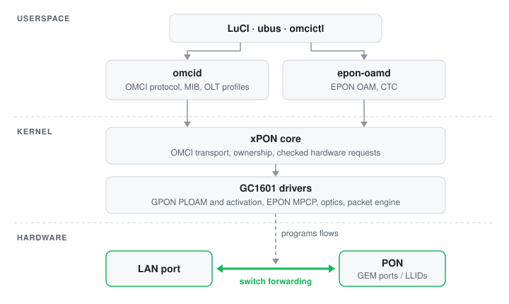

# OpenWrt for the TP-Link XZ000-G7 GPON/EPON ONU (GalaChip GC1601)

Open-source OpenWrt firmware with Linux 6.18 for the **TP-Link XZ000-G7**
GPON/EPON SFU ONU, built on the GalaChip GC1601 (GC1601A) SoC (Faraday
FA626TE, ARMv5TE). It replaces the vendor firmware and adds GPON and EPON
with a userspace OMCI daemon, hardware switch offload between the Ethernet
port and the PON at line rate, and a LuCI interface with a PON status page.
It has been tested on GPON with Nokia ISAM OLTs (Airtel Fiber, JioFiber)
and Huawei and ZTE OLTs (Airtel Fiber).

The device is an ONU bridge. Use a separate router for PPPoE/IPoE, NAT, DHCP
and firewalling. OLT provisioning and authentication requirements vary by ISP.

## Supported hardware

| | TP-Link XZ000-G7 |
| --- | --- |
| SoC | GalaChip GC1601 (GC1601A), Faraday FA626TE, ARMv5TE |
| Hardware revision | v1.0 (US1, EU1, IN, BR) |
| Memory | 32 MiB RAM, 4 MiB SPI NOR |
| Network | One Gigabit Ethernet port, GPON and EPON optical interface |
| Not covered | The 8 MiB v1.20 BR/TR variants |

## Contents

- [Status](#status) and [Features](#features)
- [Stock firmware compared](#stock-firmware-compared) and [Measured performance](#measured-performance)
- [Installation](#installation): UART, RAM boot, stock flash backup, optional U-Boot, install to flash
- [PON configuration](#pon-configuration): GPON, EPON and VLAN modes
- [Diagnostics](#diagnostics-1), [Updates](#updates), [U-Boot](#u-boot-optional) and [Recovery](#recovery)
- [Building](#building)

## Status

| Area | State |
| --- | --- |
| GPON | Working: activation, ranging, encryption, OMCI provisioning, recovery after fibre outages |
| EPON | Working: MPCP registration, OAM with CTC authentication and VLAN modes |
| Datapath | Hardware switch offload between the LAN port and the PON at line rate |
| Drivers | Vendor-free: the packet engine is a DSA switch (`lan1`, `pon0`), the PON is controlled over generic netlink, upstream-style logging |
| OMCI | Userspace responder (`omcid`), which owns the ONU identity and configuration; the kernel engine has been removed |
| LuCI | Status and configuration for GPON, EPON and the PON mode, with a light/dark theme |
| U-Boot | Optional U-Boot 2026.10 (TPL, SPL and proper), self-updating, recoverable over serial without a programmer |
| Tested OLTs | GPON: Nokia ISAM (Airtel Fiber, JioFiber); Huawei and ZTE (Airtel Fiber) |

## Features

- GPON and EPON, switchable from LuCI.
- Gigabit Ethernet with hardware bridge offload between the LAN port and the
  PON. Subscriber traffic does not pass through the CPU.
- Tagged, untagged and transparent VLAN operation, or VLANs set by the OLT.
- OMCI in userspace (`omcid`): MIB, transactions, alarms, performance data and
  OLT interoperability profiles, restartable without losing the OLT session.
- Automatic recovery after fibre outages: the service mapping is restored as
  soon as the ONU ranges again.
- ONU identity cloning (serial, vendor ID, versions, equipment ID, SLID/LOID)
  with the field limits the OMCI and CTC formats allow.
- LuCI with the stock Bootstrap theme, showing the PON as a fiber optic port
  with its optical line rate, served by uhttpd's ucode plugin, which
  compiles LuCI once instead of on every request.
- GPON and EPON status pages with receive and transmit power against the
  optical class window, the activation stages in words, what the OLT
  provisioned, and the line state in the header of every page. Settings show
  whether saving applies at once, at the next registration or interrupts
  service. A diagnostic report (identifiers masked) downloads from the status
  page.
- `luci-app-xpon-stats` for the router behind the ONU: the same GPON or EPON
  status in that router's LuCI (any theme), or `xpon-stats` in its shell, read
  from the ONU's read-only status API.
- SSH diagnostics: `omcictl`, `xponctl`, debugfs counters, an on-demand OMCI
  trace and a one-line log of what the OLT did after each reconnect.
- RAM boot and installation through the stock U-Boot, or an optional
  OpenWrt-built U-Boot 2026.10 (TPL, SPL and proper) that updates itself as one
  image, shows write progress, restores the stock firmware with one command,
  and recovers over the serial console even with a broken SPL.

## How it works



Subscriber traffic is forwarded by the switch hardware; `omcid` only
configures it. The kernel keeps what needs hardware access or tight timing
(activation, PLOAM, encryption keys, optical safety, DMA) and checks every
request `omcid` makes.

The packet engine is a DSA switch: `eth0` is the conduit, `lan1` the
Ethernet port and `pon0` the PON port, whose link is up while the ONU is
registered with the OLT. Userspace drives the PON through the `xpon` generic
netlink family (transmitter, EPON control, LAN VLAN rewrite, switch offload,
optical module readings) and `omci`'s typed backend operations; `xponctl`
is its command-line client. Register dumps and counters are in debugfs
(`/sys/kernel/debug/gc1601-pon`, `/sys/kernel/debug/gc1601-eth`).

## Stock firmware compared

The stock firmware is TP-Link's December 2024 release for this board.

### Platform

| | Stock firmware | This firmware |
| --- | --- | --- |
| Base system | Linux 3.16, uClibc, TP-Link web interface | OpenWrt, Linux 6.18, musl, LuCI |
| Source | GPL kernel parts; PON and switch drivers (`xpon_sdk.ko`, `gcnet.ko`) and the OMCI daemon (`gc_omcid`) are binary only | All drivers and daemons are source |
| Management | Web interface, TR-069 | LuCI, ubus, SSH |
| Image | Vendor firmware format | OpenWrt sysupgrade (about 3.2 MiB of the 3.4 MiB image limit) |
| Updates | Vendor images | `sysupgrade`, settings kept |

### PON stack

| | Stock firmware | This firmware |
| --- | --- | --- |
| GPON activation and PLOAM | Inside `xpon_sdk.ko` | `gc1601-gpon` driver, checked against G.984.3 (2014) with amendments 1 and 2 |
| OMCI | `gc_omcid`, closed | `omcid`, checked against G.988 (2022) with amendments 1 and 2 |
| OLT interoperability | Huawei, CTC and Boda private entities | Standard entities plus OLT profiles: auto-detect, Nokia/ALCL, Huawei, ZTE, FiberHome, Dasan |
| EPON | `gcoamd` | `epon-oamd` (IEEE 802.3 OAM, CTC authentication and VLAN modes, VSOL inter-authentication) |
| Outage recovery | Vendor state machine | Retained MIB replayed on re-range; tested with short and long fibre outages |
| Upstream FEC | Applied by the MAC when the OLT asks; no status | Same; the state is not reported by the hardware |

### OMCI MIB as seen by the OLT

ONU-created entities, compared with the stock firmware's defaults.

| Entity | Stock firmware | This firmware |
| --- | --- | --- |
| ONU2-G total GEM ports | 256 | 256 |
| ONU2-G priority queues | 144 | 160 (8 upstream per T-CONT, 8 downstream per UNI and VEIP) |
| T-CONTs / traffic schedulers | 15 / 15 | 15 / 15 |
| T-CONT deprecated attribute | 1 | 1 |
| ANI-G status reporting (DBA) | On | On (switch in LuCI) |
| Downstream priority queues | UNI and VEIP | UNI and VEIP |
| PPTP Ethernet UNIs | 1 | 1, the board's port (`omci-uni-ports`); 1-16 configurable |
| ONU-G traffic management option | 2 | 0 by default, configurable |
| Private entities | Huawei, CTC and Boda | Nokia entities with the Nokia/ALCL profile |

### Datapath

| | Stock firmware | This firmware |
| --- | --- | --- |
| Forwarding | `gcnet.ko` switch flows | Open SFU offload driver for the same switch |
| Upstream queues | Queue 0 of each T-CONT | One per P-bit (queue 0 as an option) |
| Packet buffers | 1440, with queue limits of 1080/720 | U-Boot's 512, with queue limits sized to them: a T-CONT queue holds at most 256 in and 256 out, so one fast upload cannot drain the pool |
| CPU path | Vendor bridge | `pon0` bridge, used only for traffic without a hardware flow; LAN broadcasts reach the PON once, through it |
| OLT frame size, UNI rate limits, queue weights | Applied | Not applied: their register effects are unverified, so the driver has no such hooks |

The T-CONT queue limits can be tuned live in
`/sys/kernel/debug/gc1601-eth/tcont_depth` and `tcont_out`; a setting that
would exceed the buffer pool is refused.

### Diagnostics

| | Stock firmware | This firmware |
| --- | --- | --- |
| Tools | `gc_omcicli`, vendor CLI | `omcictl`, `xponctl`, `omci-monitor`, `xpon-report`, debugfs counters |
| OMCI capture | Vendor debug | On-demand trace (`SIGUSR1` to `omcid`) |
| Reconnect log | - | One line per reconnect saying what the OLT did |

### Not included

OMCI software download, VoIP, IGMP snooping and TR-069 are not implemented.

## Measured performance

GPON on Airtel Fiber (Nokia ISAM OLT), 300/300 Mbit/s plan, PC directly on the LAN port,
Ookla on one server:

| Test | Download | Upload |
| --- | ---: | ---: |
| Single connection, CUBIC | 202-285 Mbit/s | 157-252 Mbit/s |
| Single connection, BBR | 249-261 Mbit/s | 293 Mbit/s |
| Multiple connections | about 300 Mbit/s | about 300 Mbit/s |

During single-connection tests the ONU's T-CONT queue stayed empty, its
bandwidth reports were never stuck, and no frame was dropped in either
direction: the gap is packet loss on the ISP's path, which CUBIC backs off
from and BBR does not. A single TCP upload also needs more buffering than the
stock queue limits give: with them it backs off at about 70 Mbit/s, or drains
the packet pool and hangs the engine.

GPON on JioFiber (Nokia ISAM OLT), 300/300 Mbit/s plan, PC directly on the LAN port:

| Test | Download | Upload |
| --- | ---: | ---: |
| Ookla, nearest server (3 runs) | 301-306 Mbit/s | 297-310 Mbit/s |
| 2.6 GB sustained download, 1 stream / 4 streams | 193 / 298 Mbit/s | - |
| 2.5 GB sustained upload, 1 stream / 4 streams | - | 215 / 210 Mbit/s |
| Earlier gigabit plan, same OLT | about 900 Mbit/s | about 920 Mbit/s |

In both directions the switch forwarded everything: over more than 5 GB the
CPU handled a few dozen packets, its load stayed below 0.4, and the ONU
counted no uncorrectable FEC codewords or BIP errors. Single-stream results
depend on the server and route: the download test used a speed-test server
about 12 ms away, the upload test Cloudflare's nearest site.

## Standards

- ITU-T G.984.3 (2014) with amendments 1 (2020) and 2 (2025): GPON
  transmission convergence, PLOAM and activation.
- ITU-T G.988 (2022) with amendments 1 (2024) and 2 (2025): OMCI.
- ITU-T G.984.2 (2019): GPON physical layer, within what this board's optics
  support.
- IEEE 802.3: Ethernet OAM and EPON (MPCP in hardware).
- ITU-T G.Sup46 / BBF TP-247: interoperability and conformance test plans used
  as checklists. This firmware is not certified.

The hardware knowledge (register layouts, initialisation order, optics
calibration) comes from the stock firmware; the protocol behaviour comes from
the standards.

## Installation

Back up the unit, boot OpenWrt from RAM, optionally replace the boot loader
with the OpenWrt U-Boot, then install with `sysupgrade`.

### 1. Requirements

- A 3.3 V USB-UART adapter, Ethernet cable and the board's normal power supply.
- A PC with a serial terminal, TFTP server and SCP client.
- These two images from the same build:

  - `openwrt-galachip-gc1601-tplink_xz000-g7-initramfs-zImage`
  - `openwrt-galachip-gc1601-tplink_xz000-g7-squashfs-sysupgrade.bin`

- For the optional U-Boot, also these two:

  - `openwrt-galachip-gc1601-tplink_xz000-g7-u-boot.bin`
  - `openwrt-galachip-gc1601-tplink_xz000-g7-u-boot-with-spl.bin`

Verify image checksums. Keep the fiber disconnected during installation.
Do not upload these images through the stock firmware's web interface.

### 2. Connect UART and Ethernet

Connect the UART with board power disconnected:

| G7 pad | USB-UART |
| --- | --- |
| GND | GND |
| TX | RX |
| RX | TX |
| VCC | Not connected |

Use the normal power supply. Set the terminal to **115200, 8N1, no flow
control**. Interrupt autoboot to reach the stock U-Boot `=>` prompt.

Connect the PC directly by Ethernet and set its address to
`192.168.1.10/24`. The G7 uses `192.168.1.1`; no DHCP server is included.
Place the initramfs image in the TFTP root under its build name.

### 3. Boot from RAM

Run these at the stock U-Boot prompt, **one line at a time**:

```text
setenv autostart no
setenv ipaddr 192.168.1.1
setenv serverip 192.168.1.10
mw.l 9080000c 0
setenv bootargs console=ttyS0,115200n8 earlycon
tftpboot 41000000 openwrt-galachip-gc1601-tplink_xz000-g7-initramfs-zImage
```

The `mw.l` command disables the watchdog for this loader session.
After a successful transfer, confirm the byte count matches the file, then:

```text
bootz 41000000
```

This does not write flash. Do not run `saveenv` or change `bootcmd`.

### 4. Back up the stock flash

In the RAM-booted OpenWrt shell, check:

```sh
cat /proc/mtd
```

The main regions must match this layout:

| Partition | Offset | Size |
| --- | --- | ---: |
| `u-boot` | `0x000000` | 128 KiB |
| `firmware` | `0x020000` | 3776 KiB |
| `misc` | `0x3d0000` | 128 KiB |
| `hwconfig` | `0x3f0000` | 64 KiB |

Child partitions such as `kernel`, `rootfs` and `rootfs_data` are normal.
Stop if the main layout differs. Never erase `u-boot`, `misc` or `hwconfig`;
they contain the boot chain and factory data.

Create backups while stock firmware is still in flash:

```sh
(
    set -e
    mkdir /tmp/g7-stock-backup
    for p in u-boot firmware misc hwconfig; do
        d=$(awk -v label="\"$p\"" '
            $4 == label { sub(/:$/, "", $1); print $1 }
        ' /proc/mtd)
        [ -n "$d" ] || { echo "Missing partition: $p"; exit 1; }
        dd if="/dev/$d" of="/tmp/g7-stock-backup/$p.bin" bs=65536 || exit 1
    done
    wc -c /tmp/g7-stock-backup/*.bin
)
```

Expected sizes in bytes: `u-boot.bin` 131072, `firmware.bin` 3866624,
`misc.bin` 131072 and `hwconfig.bin` 65536. Do not continue after a read error.

Set a password on the G7 with `passwd`, then run on a Linux PC:

```sh
mkdir -p g7-stock-backup
scp -O 'root@192.168.1.1:/tmp/g7-stock-backup/*.bin' g7-stock-backup/
cd g7-stock-backup
wc -c *.bin
sha256sum u-boot.bin firmware.bin misc.bin hwconfig.bin > SHA256SUMS
cat u-boot.bin firmware.bin misc.bin hwconfig.bin > g7-stock-full.bin
wc -c g7-stock-full.bin
```

The full backup must be **4194304 bytes**. Keep copies off the device and
private; they contain calibration and device/ISP identifiers. Windows
clients should use SCP rather than SFTP.

### 5. Install the OpenWrt U-Boot (optional)

Skip this step to keep the stock boot loader. The OpenWrt U-Boot boots
faster, protects `misc` and `hwconfig`, flashes and restores firmware with
one command and recovers over the serial console; see
[U-Boot](#u-boot-optional).

With the backups stored on the PC, reboot the G7 and interrupt autoboot at
the stock U-Boot prompt. Place both U-Boot files in the TFTP root under their
build names and run, one line at a time:

```text
setenv autostart no
setenv ipaddr 192.168.1.1
setenv serverip 192.168.1.10
mw.l 9080000c 0
tftpboot 41000000 openwrt-galachip-gc1601-tplink_xz000-g7-u-boot.bin
go 41000000
```

This starts the OpenWrt U-Boot from RAM, without writing flash. At its
`=>` prompt, install it:

```text
run upgrade_uboot
```

It checks the TPL the way the chip's mask ROM does and the SPL and U-Boot
proper by their CRCs before writing, rewrites only the blocks that changed,
and reads them back to compare. Do not power off while it writes. Then
`reset` and press a key within 3 s to stop autoboot at the new `=>`
prompt; left alone, it boots the stock firmware still in flash. Details in
[INSTALLATION.md](package/boot/uboot-galachip/INSTALLATION.md).

### 6. Install to flash

With the OpenWrt U-Boot from step 5, put the sysupgrade image in the TFTP
root and, at its `=>` prompt (press a key within 3 s of power-on):

```text
run upgrade_tftp
boot
```

It checks the image's tag and size before writing. Otherwise, boot OpenWrt
from RAM again (step 3) and copy the matching sysupgrade image from the PC:

```sh
scp -O openwrt-galachip-gc1601-tplink_xz000-g7-squashfs-sysupgrade.bin \
    root@192.168.1.1:/tmp/g7-sysupgrade.bin
```

On the G7, validate it:

```sh
sysupgrade -T /tmp/g7-sysupgrade.bin
```

Only after validation succeeds and backups are stored on the PC:

```sh
sysupgrade -n /tmp/g7-sysupgrade.bin
```

This replaces the firmware region and reboots with default settings.
Do not interrupt power or use `-F`. After reboot, open
`http://192.168.1.1` and set a root password.

## PON configuration

Select **Network -> PON Mode** and reboot after changing technology.
Enter only your ISP-authorized identity and authentication details.

### GPON

Open **Network -> GPON -> Configuration -> General settings**.

- Set the GPON serial and password/LOID required by the ISP. Each field
  shows its length limit.
- Start with automatic OLT detection and no forced profile.
- Leave ONU type, UNI count, OMCC version and traffic-management overrides
  at their defaults unless required by the ISP. Each choice in these lists
  says what it means.
- **Profiles** fills the identity of a known ISP ONT in one step.
- **Report queue status for DBA** is on by default, as on the stock firmware.
  Turn it off only if the OLT's upstream bandwidth allocation misbehaves.

### EPON

Open **Network -> EPON -> Configuration**.

- Set the authorized ONU MAC and LOID/password if required.
- Leave active OAM discovery disabled unless registration succeeds but OAM
  remains waiting for discovery.

### VLAN mode

| Mode | Behavior |
| --- | --- |
| Transparent | Passes tags through; configure the service VLAN on the router if required. |
| Tagged | Adds the service VLAN upstream and removes it downstream; the router sends untagged traffic. |
| OLT-controlled | Applies the VLAN configuration supplied by the OLT. |

GPON labels the last option **Control by OLT**; EPON uses **Set by the OLT**.
Keep the default Ethernet/PON bridge and avoid tagging the same service twice.

Connect the fiber and check the corresponding GPON or EPON status page.
Use a different management subnet if your router also uses `192.168.1.0/24`.

## Diagnostics

```sh
# The PON: transmitter, EPON state, LAN VLANs, offload, optical readings
xponctl get

# GPON
omcictl status
cat /sys/kernel/debug/gc1601-pon/gpon_state

# EPON
cat /var/run/epon-oamd.json
cat /sys/kernel/debug/gc1601-pon/epon_state
cat /sys/kernel/debug/gc1601-pon/epon_offload_status

# Ethernet and offload
ethtool lan1
ethtool -S pon0
cat /sys/kernel/debug/gc1601-eth/sfu
dmesg | grep "SFU offload"
```

GPON should reach `O5`. EPON needs MPCP registration and an operational OAM
link. The kernel log lists each flow the switch forwards, with its GEM port
and T-CONT, whenever the set changes; an enabled offload setting alone does
not confirm that traffic matches a hardware flow.

After each reconnect, `omcid` logs one line saying what the OLT did, for
example `omcid: OLT after 33 s dark: MIB reset and full reprovision; …`:

```sh
logread | grep "OLT after"
```

To capture OMCI, start and stop a trace with the same command, then read it.
The trace contains raw OMCI including identity data; keep it private.

```sh
kill -USR1 $(pidof omcid)
omci-monitor -r /tmp/omcid-trace.txt
```

## Updates

Back up your configuration, transfer the new sysupgrade image to `/tmp`,
and run:

```sh
sysupgrade -T /tmp/g7-sysupgrade.bin
```

If validation succeeds, update while retaining compatible settings:

```sh
sysupgrade /tmp/g7-sysupgrade.bin
```

Use `-n` for a clean configuration. Check operation after a power-off cold boot.
The 4 MiB flash leaves little room for additional packages.

## U-Boot (optional)

The build also publishes an upstream U-Boot 2026.10 for the G7, under
upstream U-Boot's file names, documented in
[package/boot/uboot-galachip](package/boot/uboot-galachip/README.md). It is
written for the GalaChip GC1601 SoC: the G7 adds only its DDR settings, its
device tree and its file names, so another GC1601 ONU or SFP stick needs only
those. The SPL unpacks U-Boot in 0.12 s and U-Boot loads the kernel in
0.1 s, with the caches on and the flash read over two lanes at 100 MHz;
autoboot waits 3 s for a key.

What it does differently from the stock loader, all tested on the board:

- **Upstream boot chain.** The mask ROM starts U-Boot TPL in SRAM, which
  sets up DDR and loads U-Boot SPL, which unpacks U-Boot proper. Each stage
  checks the next one's CRC and takes it over YMODEM on the serial console
  when the flash copy is bad, so a broken loader recovers without a
  programmer; a broken TPL recovers through the mask ROM's UART menu.
- **Same device tree as Linux.** The SoC and board `.dts` files are shared
  with the kernel; U-Boot reads the flash layout, the factory MAC and the
  protected ranges from them instead of hardcoding addresses.
- **Faster boot.** Dual-output flash reads at 100 MHz and the caches on: the
  whole 4 MiB flash reads in 1.05 s (1.64 s before), and U-Boot proper
  unpacks in 0.12 s instead of 2.5 s without the D-cache.
- **Upstream drivers and conventions.** FTWDT010 watchdog with reset through
  it, FTTMR010 timer, upstream ARM926 CPU code, the default `=> ` prompt, and
  `boot` for the default boot.
- **Protected factory data.** The flash driver refuses to program or erase
  `misc` and `hwconfig` and refuses a chip erase. The flashing scripts check
  the image tag and size first, rewrite only the 4 KiB blocks that changed,
  and read back to compare.
- **Self-update and stock restore.** `run upgrade_uboot` replaces the whole
  loader in place; `run restore_stock` puts the stock firmware back from
  this unit's backup and keeps the new loader.

| File (`openwrt-galachip-gc1601-tplink_xz000-g7-…`) | NOR | Use |
| --- | --- | --- |
| `…-u-boot-with-spl.bin` | `0`, 128 KiB | The whole boot loader, TPL, SPL and proper: `run upgrade_uboot` |
| `…-u-boot.bin` | none, runs from RAM | Chainloaded with `tftpboot 41000000` and `go 41000000`, for the first install |
| `…-u-boot-tpl.bin` | `0`, up to 8 KiB | TPL with the mask ROM's header: recovery over the ROM's serial menu, or an SPI programmer |
| `…-u-boot-spl.img` | `0x2000`, 32 KiB | SPL; the TPL takes it over YMODEM when the flash copy is broken |
| `…-u-boot.img` | `0xa000`, 88 KiB | U-Boot proper, LZMA; the SPL takes it over YMODEM when the flash copy is broken |

To install it, follow
[step 5 of the installation](#5-install-the-openwrt-u-boot-optional). Later updates are `run upgrade_uboot` from the installed
U-Boot, with the new `…-u-boot-with-spl.bin` in the TFTP root.

Useful commands at the `=>` prompt: `boot` (the default boot from flash),
`run boot_tftp` (RAM boot of the initramfs), `run upgrade_tftp` (flash the sysupgrade image), `run backup_flash`
(TFTP the whole 4 MiB NOR to the PC as `xz000-g7-flash.bin`) and
`run restore_stock` (write this unit's raw `firmware.bin` backup, served as
`g7-stock-firmware.bin`, verify it and boot stock). `sf erase`, `sf write`
and `sf update` show a progress bar with the speed. The flash driver refuses to
program or erase `misc` and `hwconfig`, and to erase the whole chip; elsewhere
`sf` writes wherever it is told, so never type a write address by hand.
Sysupgrade never touches the boot loader.

## Recovery

With a working stock U-Boot, repeat the RAM-boot procedure and reinstall
OpenWrt. To return to stock, use **this unit's original raw `firmware.bin`
backup**, exactly **3866624 bytes**. A vendor update file is not equivalent.

Place the backup in the TFTP root as `g7-stock-firmware.bin`. Disconnect the
fiber and run at the stock U-Boot prompt:

```text
setenv autostart no
setenv ipaddr 192.168.1.1
setenv serverip 192.168.1.10
mw.l 9080000c 0
tftpboot 41000000 g7-stock-firmware.bin
printenv filesize
sf probe
```

Stop unless the transfer succeeded, `filesize` is `3b0000` and the flash
is **4 MiB**. The following commands erase and replace only the firmware region:

```text
sf erase 20000 3b0000
sf write 41000000 20000 3b0000
sf read 40c00000 20000 3b0000
cmp.b 41000000 40c00000 3b0000
```

Require `Total of 3866624 byte(s) were the same` before power-cycling.
If verification fails, keep power on and retain the serial session. With the
OpenWrt U-Boot installed, `run restore_stock` does all of this in one step.

If the boot loader itself is broken: with a broken SPL or U-Boot proper, the
TPL or SPL waits for `…-u-boot-spl.img` or `…-u-boot.img` over YMODEM
(`sb` from lrzsz). For one that loads but hangs, hold any key down in the
terminal while powering on: the TPL and the SPL then take YMODEM first. With a broken TPL, the chip's mask ROM stops at a
`1. SPI-NOR / 2. UART(Xmodem)` menu. Send the TPL over the serial console
with [rom-xmodem.py](package/boot/uboot-galachip/tools/rom-xmodem.py)
(standard XMODEM senders fail with this ROM). Then `run upgrade_uboot`:

```sh
python3 rom-xmodem.py /dev/ttyUSB0 openwrt-galachip-gc1601-tplink_xz000-g7-u-boot-tpl.bin
```

Damage to `misc` or `hwconfig` can only be repaired from this unit's own
backup with an external SPI programmer.

## Building

Kernel additions are included in [target/linux/galachip](target/linux/galachip).
PON packages are in [package/utils/xpon](package/utils/xpon).
No separate kernel checkout is required.

On an OpenWrt build host:

```sh
./scripts/feeds update -a
./scripts/feeds install -a
cp target/linux/galachip/tplink_xz000-g7.diffconfig .config
make defconfig
make -j"$(nproc)"
```

The seed selects the same packages as the released images. Save any
existing `.config` before replacing it. Images are generated in
`bin/targets/galachip/gc1601/`. Do not publish private ISP settings or factory
backups.

## Credits and license

Based on OpenWrt, Linux and LuCI.

The GPON parts of `xpon-agent` and `luci-app-xpon` (formerly `omci-agent` and
`luci-app-omci`) are based on the original Airoha GPON OMCI packages by [@Sirherobrine23](https://github.com/Sirherobrine23)
(**Matheus Sampaio Queiroga**).

The optical power gauges, activation stages, apply-cost badges, line status in
the header and diagnostic report download on the GPON and EPON pages follow
ideas from [odi-ui](https://github.com/AndreZiviani/odi-ui) by
[@AndreZiviani](https://github.com/AndreZiviani) (**Andre Ziviani**). No code
was copied.

Original authorship and file-level license notices are retained.
OpenWrt is licensed under GPL-2.0; component licenses remain applicable.
